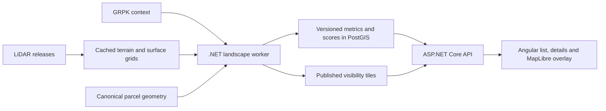

# Landscape potential: implementation plan

Prepared: 6 October 2026. Status: proposed feature; no scoring or terrain-processing code has been implemented.

## 1. Outcome

Help a user shortlist Lithuanian land offers whose surroundings may suit a scenic, secluded retreat. Add a reproducible **landscape potential score from 0 to 100**, component explanations, data-quality information, and an optional map of estimated visibility from a sampled point within the parcel.

The score describes the physical parcel and its surroundings. Ownership, rental conditions, access rights, and permission to establish a dwelling remain separate facts or checks. A high landscape score does not establish off-grid feasibility.

Start with a manually selected pilot of 20 distinct, mapped parcels. Validate the results against imagery and the user's preferences, then process the remaining mapped parcels in the current catalogue. A parcel outside usable source coverage remains explicitly unscored.

## 2. Fit with the existing prototype

The existing stack remains ASP.NET Core/.NET 10, Angular 22 with signals and native fetch, PostgreSQL/PostGIS, and MapLibre. Add a separate .NET worker for terrain processing, using PDAL/GDAL command-line tools behind Infrastructure adapters.



Existing integration points:

| Existing component | Planned change |
| --- | --- |
| `Fluxus.Core/Auctions.cs` | Preserve sale/rental and ownership semantics; introduce separate landscape contracts and scoring rules. |
| `Fluxus.Infrastructure/Persistence/CatalogueDb.cs` | Add parcel analyses, jobs, and dataset-version records through a migration. |
| `PostgresCatalogueStore.SaveAuctionAsync` | After an accepted geometry update, optionally enqueue landscape work; price or status changes alone do not trigger processing. |
| `Fluxus.Api/CatalogueEndpoints.cs` | Join compact published score summaries into card/map responses; support landscape filtering and sorting. |
| `Fluxus.Web/src/app/catalog-api.ts` | Validate new summary/detail contracts and share new filters in the URL. |
| `app.html` / `app.ts` | Add score badges, explanations, filtering, sorting, and optional landscape detail sections. |
| `auction-map.ts` | Add one selected visibility overlay and its observation point without changing auction markers or parcel boundaries. |
| `deploy/compose.yaml` | Add an optional worker service and a shared artifact volume. Keep GDAL/PDAL out of the web runtime. |

Store and reuse analyses by canonical **ParcelId**, not AuctionId or offer ID. Two ownership-share offers for the same parcel receive the same landscape assessment. Each offer keeps its own ownership/rental notices. Mixed auctions receive per-parcel scores; there is no whole-auction landscape average in v1.

## 3. Scope and product rules

### Required for v1

- A versioned, explainable landscape score with four components: views, terrain character, natural surroundings, and seclusion.
- Several observation points inside the actual cadastral polygon, with separate median and best sampled view results.
- Ground elevation for terrain analysis and vegetation/building surfaces for obstruction-aware visibility.
- Source dates, resolution, coverage, processing date, limitations, and an explicit analysis state.
- A selected visibility overlay, labeled as a modeled estimate from a specific point and height.
- Minimum-score filtering and highest/lowest-score sorting alongside existing sale/rental, ownership, price, and municipality controls.
- Small practical context facts: gentle-ground area, mapped-road proximity, and inherited ownership/rental information. Access rights and building feasibility initially show as unverified.
- Durable, bounded processing with reuse, retries, last-good results, and a manual pilot/backfill command.

### Follow-up scope

Custom scoring weights and saved preference profiles; user-selected observation points; seasonal canopy models; verified access routes; flood/protected-area integrations; solar-yield estimates; a separate off-grid suitability score; immersive 3D terrain; nationwide preprocessing; public job submission; and machine-learning beauty prediction.

### Meaning of the score

- Treat it as a preference-based screening index, not a measured probability that someone will find a site beautiful.
- Publish integer scores and raw component facts. Do not imply precision with decimal scores.
- Missing inputs are unknown, never zero. Do not redistribute their weights to produce an artificially complete score.
- Publish an overall score only when all four required components meet the v1 input-quality rules. Otherwise show available metrics and `partial`, with a null overall score.
- Separate data quality from desirability: older coverage can support an assessment but must show its survey date and limitations.
- Keep the landscape score independent of auction price and offered ownership fraction.
- Never suggest a sampled point belongs to the specific owner of a fractional share, or is an approved cabin site.

## 4. Sources and the first validation gate

The following source findings were checked during planning. Actual downloaded tile contents, regional coverage, acquisition steps, and tool compatibility still need validation.

| Source | Intended use | Checked fact / remaining work |
| --- | --- | --- |
| NŽT `Lidar_DR_LT` via Geoportal | Ground, vegetation, and building elevations | Official publications describe classified LiDAR and newer coverage for parts of Lithuania. Verify the exact selected dataset's license, downloadable files, spatial/vertical reference systems, classification flags, and per-tile survey dates. Do not assume one publication covers every parcel. |
| GRPK open data | Forest/land-cover context, water, buildings, transport | Official metadata lists these categories, EPSG:3346, download archives, and CC BY 4.0. The open release is a subset of full GRPK. Inspect actual layers/fields before promising that a specific object type is complete. |
| Geoportal/Copernicus land-cover products | Optional replacement where GRPK lacks usable land-cover categories | Geoportal lists forest, grassland, water/wetland, and other products. Check resolution, dates, classes, and license before choosing a specific release. |
| Orthophotography | Human validation of terrain, vegetation, and nearby development | Choose a source whose imagery date and permitted use can be recorded. Imagery does not generate the v1 numeric score. |

Primary references:

- [SSVA: newer LiDAR coverage and classification](https://www.ssva.lt/cms/en/news/geoportal-lt-paviesinti-naujausi-lidar-duomenys-dali-lietuvos-teritorijos-galima-matyti-dar-detaliau).
- [Geoportal LiDAR catalogue entry](https://www.geoportal.lt/metadata-catalog/catalog/search/resource/details.page?uuid=%7B3C0D5E47-49CA-4132-88C1-EC3D1E4610B4%7D). The full metadata fetch timed out during planning; exact reuse/access conditions are still to be checked.
- [GRPK open-data metadata](https://www.geoportal.lt/metadata-catalog/catalog/search/resource/details.page?uuid=%7B83C067E7-7EE1-4AF2-B573-2CC09250E70C%7D).
- [Geoportal open data and land-cover products](https://www.geoportal.lt/geoportal/atviri-duomenys).
- [PDAL point-cloud raster writer](https://pdal.io/en/stable/stages/writers.gdal.html).
- [GDAL viewshed calculation and input limitations](https://gdal.org/en/stable/programs/gdal_viewshed.html).

### M0 deliverables: source feasibility

1. Select three pilot areas representing open/hilly ground, forested ground, and a water-adjacent parcel.
2. Acquire only the required sample tiles. Record access method, actual bytes, license/attribution, coverage, survey dates, horizontal/vertical units and datums, and hashes.
3. Confirm PDAL/GDAL can read the actual source format in the intended Linux worker image. Pin tested tool versions and the image digest after this experiment.
4. Confirm source class codes and exclude withheld/noise points according to the dataset specification. Use supplied classifications first; do not automatically reclassify all points.
5. Produce aligned terrain/surface grids and inspect them against the source and imagery, including water gaps and tile boundaries.
6. Inspect GRPK field meanings and prove that forest, water, building, and selected road classes can be extracted for these areas.
7. Measure one end-to-end parcel analysis: download size, disk use, processing time, peak memory, and quality of the visibility overlay.
8. Save a source-validation record and a reusable, appropriately licensed test sample or derived fixture. Record any redistribution restrictions.

**Exit condition:** at least one representative parcel has a valid terrain/surface pair, context inputs, reproducible metrics, and a visibility result. Coverage/access failures produce a revised coverage plan before broad backfill. Do not substitute an attractive hillshade screenshot for numerical elevation data.

## 5. Spatial analysis pipeline

All numerical distance, area, slope, and visibility work uses a verified metric projected CRS, initially EPSG:3346. Preserve EPSG:4326 for public vector API geometry and transform raster overlays to EPSG:3857 for MapLibre tiles. Validate source height units and vertical datum before merging elevation products.

### 5.1 Analysis extents and initial resolution

| Extent | Initial purpose |
| --- | --- |
| Cadastral polygon and a 100 m margin | Ground slope, contiguous gentle patches, observation-point generation |
| 500 m buffer | Immediate surroundings and nearby buildings |
| 1 km buffer | Natural-cover proportions, forest/water context, building density, road context |
| 3 km around each observation point | Visibility and surrounding terrain character |

The processing footprint is the union of those extents, including all polygon components and all observation-point disks. Clip metrics to their declared extent; a bounding rectangle is only a processing convenience.

Start with a 2 m terrain grid for parcel statistics and a 5 m terrain/surface grid for viewsheds. These are proposed working resolutions, not claims about every source's native quality. Never upsample a coarse source and label it 2 m evidence. Confirm the trade-off in M0; any later radius or resolution change creates a new analysis version.

Build and cache regional grids once. Align origin, extent, cell size, CRS, and NoData values for terrain, surface, cover, and valid-data masks. Coarsening the obstruction surface should preserve meaningful tree/building heights; test that narrow obstacles do not disappear. Avoid mosaicking inconsistent height datums. Record mixed survey dates when a footprint spans multiple acquisitions.

### 5.2 Surface preparation

- DTM: a ground-elevation grid derived from the verified ground class or a validated official terrain raster.
- Obstruction surface: terrain plus vegetation/building elevations, excluding source noise classes. Record interpolation and resampling methods.
- Preserve data-validity masks. A gap, missing foreign-border tile, or unobserved water surface is not automatically flat ground.
- Fill gaps only through a documented, validated elevation source or a separately versioned interpolation method with an error check. Keep the original gap mask and report the substitution.
- The v1 viewshed path requires complete valid terrain/obstruction inputs throughout each tested disk. Otherwise mark that point unavailable. If fewer than the required representative points are valid, withhold the views component and overall score.
- GDAL documents that its viewshed calculation does not specially handle input NoData values. The adapter must validate masks before invoking it; assigning zero to missing cells is prohibited.

### 5.3 Observation points

1. Generate deterministic candidate points within the polygon, respecting holes and disconnected components. Use a common sampling rule rather than the existing map marker alone.
2. Sample spatially separated positions and elevation bands. Cap processing at 16 points per parcel; record which components were sampled and what portion of the parcel they represent.
3. Prefer representative accessible-looking ground, with slope as a sampling factor. Slope is not evidence of permission or actual access. Do not quietly exclude all steep or wooded parcels from analysis.
4. Require at least three adequately spaced, valid points for a parcel-level median view score. For a parcel too small to support three distinct 5 m observation cells, analyze one valid interior point and explicitly record `single_point` sampling. Large parcels with inadequately sampled components remain partial.
5. Set eye height to 1.7 m above the local DTM. Do not place the observer on a treetop, roof, or the highest DSM cell.
6. When using the obstruction surface as GDAL's input, calculate the observer offset from the absolute eye elevation: `DTM_at_point + 1.7 - surface_at_point`. Validate this behavior with an observer-under-canopy fixture during M0. If the chosen tool cannot model it reliably, retain terrain-only results as diagnostic output and defer the full views component until the adapter is corrected.

Store point coordinates, eye elevation, source quality, individual view metrics, and validity reasons. The highest sampled viewpoint is not the automatic score for the whole parcel.

### 5.4 Metrics to persist

| Group | Raw metrics |
| --- | --- |
| Views | Surface-aware visible area within 3 km; open-horizon fraction; visible natural/water cover; median and best sampled view component; terrain-only diagnostic visibility |
| Terrain | P10/P90 ground elevation and relief; slope distribution; terrain-position/valley/ridge indicators; sampled directional horizon distances |
| Nature | Forest/meadow/water proportions within 1 km; distance to forest edge and water boundary; visible water; land-cover diversity |
| Seclusion | Nearest mapped building; building count/density within 500 m and 1 km; distance to selected major road classes; visible built-up area |
| Practical context | Total and largest contiguous gentle-ground area; nearest mapped-road distance; basic aspect/exposure facts; offer ownership/rental information from the existing model |
| Quality | Valid raster coverage; observer count/spatial coverage; actual resolution; acquisition date range; substitutions; classification/coverage limitations |

Use nearest mapped **building**, not “nearest home”, unless the source explicitly supports residential classification. Road distance is a geographic proximity fact, not proof of an access route or right. Exposure is a terrain indicator, not a solar-energy estimate. Wetness/flood modeling is deferred.

The initial gentle-ground threshold is slope at or below 8 degrees. Report both its total area and the largest contiguous patch, using a documented cell-connectivity rule. This threshold is a screening parameter, not a construction criterion.

## 6. Scoring specification

Use a fixed `balanced-retreat-v1` profile for the initial release. The weights below are proposed starting preferences and must be calibrated; they are not an established scientific beauty model.

```text
LandscapeScore = round(
    0.35 * Views +
    0.20 * TerrainCharacter +
    0.30 * NaturalSurroundings +
    0.15 * Seclusion
)
```

Each component lies in [0, 100]. Its application-level scorer consumes normalized metrics and has no GDAL, EF Core, or HTTP dependency.

### Initial component definitions

| Component | Initial internal weights | Normalization to settle in the pilot |
| --- | --- | --- |
| Views | 60% visible area, 25% open-horizon fraction, 15% visible natural-cover diversity | Log-scaled visible area prevents very broad views dominating everything; freeze lower/upper anchors after inspecting pilot distributions. Use the median point score; report the best point separately. |
| Terrain character | 65% robust surrounding relief, 35% ridge/valley variation | Use robust elevation quantiles and a documented terrain-position measure. Saturate at the agreed preferred range; increasingly extreme slopes must not keep raising the score without limit. |
| Natural surroundings | 50% natural-cover proportion, 25% forest-edge context, 25% water context | Define forest-edge preference explicitly. Combine visible water and proximity without pretending nearby water is visible. Meadow/forest/water classes and weights are versioned. |
| Seclusion | 60% building context, 40% major-road context | Smooth distance/density functions; mapped absence counts only where dataset coverage is valid. This is a seclusion proxy, not a noise measurement. |

Implementation must include a checked-in profile configuration with exact formulas, units, normalization anchors, component weights, and missing-input requirements. M0/M3 establish numeric anchors; M4 freezes them before scores become a normal sorting/filtering option.

### Concrete draft normalization for the first pilot

These values make the first implementation testable. They are starting preferences to review during M4, not empirically established beauty thresholds. Define `u(x) = clamp(x, 0, 1)`.

| Metric contribution | Draft formula |
| --- | --- |
| Visible area | `u(log(1 + visibleAreaKm2) / log(1 + 20))`, measured within the 3 km observation disk |
| Distant-view directions | Divide the horizon into 36 ten-degree sectors. The contribution is the fraction containing surface-visible cells between 1.5 and 3 km. Describe this as directional view openness, not an exact skyline survey. |
| Visible natural-cover diversity | Normalized Shannon diversity of visible forest, open-natural, and water cover: `H / log(3)`; zero where no natural cover is visible and coverage is otherwise known |
| Robust terrain relief | `u((P90ElevationM - P10ElevationM) / 60)` over the surrounding 3 km footprint |
| Ridge/valley variation | `u(stddev(TPI_M) / 12)`, where TPI is elevation minus the local 500 m-radius mean ground elevation |
| Natural-cover proportion | Forest, meadow/open-natural, and water area divided by the valid 1 km context area; classes and overlap precedence come from the verified schema mapping |
| Forest-edge context | Contribution 1 within 200 m of a mapped forest edge; linear decline to 0 at 1 km. Fully wooded interiors still contribute through natural-cover proportion. |
| Water context | `0.5 * u(1 - nearestWaterDistanceM / 1000) + 0.5 * u(visibleWaterFraction / 0.02)`. Keep proximity and visibility explanations separate. |
| Building context | `0.5 * u((nearestBuildingDistanceM - 50) / 950) + 0.5 * exp(-buildingCountWithin1Km / 20)`. No mapped building within a verified 1 km coverage area saturates the distance term at 1. |
| Major-road context | `u((nearestMajorRoadDistanceM - 100) / 1400)`; saturation beyond 1.5 km requires verified road coverage through that radius |

Calculate view contributions independently at each valid point and take their median for the Views component. Define the other distance/context calculations at the same representative point nearest that median; report parcel-wide terrain/practical metrics separately. Keep aggregation rules fixed to avoid combining a view from one corner with attractive nearby context from another.

Initial data-quality labels: high requires complete required inputs, adequate sampling, no substitutions, and relevant terrain/surface surveys no older than three years; medium allows surveys up to eight years old; low covers older surveys, verified substitutions, or the documented tiny-parcel single-point case. Unknown acquisition dates or unsupported required inputs yield partial analysis until their provenance is established. Record the quality-rule version; never reduce a missing-input problem to a low scenic score.

Do not calculate live percentiles across the changing auction catalogue. An unchanged parcel should not change score merely because new auctions were imported. Persist raw metrics separately from score/profile versions so weights can be recalibrated without repeating LiDAR processing.

Generate explanations from actual metrics and named thresholds, for example “varied surrounding relief”, “forest edge within 200 m”, or “water nearby; visibility not established”. No free-form AI inference is needed for v1. A reason must be reproducible from stored evidence.

## 7. Persistence and job orchestration

### Tables

| Table | Key contents |
| --- | --- |
| `landscape_dataset_versions` | Provider/product, immutable release ID, acquisition-date range, coverage geometry, CRS/vertical datum, native/working resolution, license/attribution, manifest checksum, local asset references |
| `landscape_jobs` | Parcel ID, geometry hash, dataset-bundle hash, analysis version; state, priority, attempts, next attempt time, lease owner/expiry, timestamps, safe failure code |
| `parcel_landscape_analyses` | Immutable successful/partial run, input hashes and versions, raw-metric JSONB, viewpoints JSONB, component scores, nullable composite, quality reasons, observation/processing dates, published artifact manifest |

Keep a small current-result pointer per parcel, or an equivalent indexed projection. The current projection exposes indexed score/status columns for catalogue filtering. Profile recalculation may append a new scored result reusing the same metric/artifact bundle.

The deduplication key is `(ParcelId, normalized geometry hash, dataset bundle hash, analysis version)`. Score publication also records its profile/score version. A geometry hash uses deterministic normalized geometry; a price/status refresh does not affect it.

### Worker behavior

- Claim jobs atomically through PostgreSQL row locks/`SKIP LOCKED` and renewable leases. Begin with one job at a time.
- Run PDAL/GDAL through an allowlisted executable and structured argument list. Use owned working directories, cancellation, timeouts, and bounded stdout/stderr; never concatenate provider text into shell commands.
- Reuse immutable regional rasters by dataset release, spatial grid, resolution, and processing version.
- Retry transient download/process failures at most three times, with increasing delays. Coverage gaps and unsupported formats wait for a dataset/tool change rather than a tight retry loop.
- On cancellation or restart, allow expired leases to be reclaimed. Publish database results only after artifacts exist and their checksums validate.
- Retain last-good results. If their geometry or required source version no longer matches the desired result, expose them as stale historical context and exclude them from current-score filtering/sorting.
- Separate processing state from result quality: a pending/failed replacement can coexist with a previously published result. Do not overwrite a valid result with a transient worker error.
- An offer with unresolved/conflicting parcel identity cannot receive a score through a speculative association, even if a similarly numbered parcel has an analysis.

The first release uses manual commands equivalent to `landscape enqueue --limit 20`, `landscape process --once`, and `landscape backfill --mapped-only`. Import-triggered enqueueing is configurable and off initially. There is no expensive computation or source download inside a GET request.

## 8. API contracts

Extend `ItemCard` and its GeoJSON properties with a small nullable `landscape` summary:

```json
{
  "landscape": {
    "analysisId": "<uuid>",
    "status": "ready",
    "score": 78,
    "profile": "balanced-retreat-v1",
    "dataQuality": "medium",
    "surveyYearRange": [2020, 2026],
    "computedAt": "<ISO timestamp>"
  }
}
```

This is an illustrative response, not a computed result. Quality is a rule-based data label, not a statistical confidence probability. Document its criteria: coverage, resolution, survey age, substitutions, and sampling adequacy. Keep source uncertainty visible even when a composite is available.

| Endpoint/change | Behavior |
| --- | --- |
| `GET /api/auction-parcels/{offerId}/landscape` | Validate offer-to-parcel association; return published summary, components, raw facts, explanations, source provenance, selected representative viewpoint, practical context, and replacement-job state. |
| `GET /api/landscape/analyses/{analysisId}/tiles/{z}/{x}/{y}.png` | Serve only published, bounded XYZ overlay artifacts; no processing on request. Allowlisted zooms and tile bounds; immutable cache headers. |
| Existing `/api/catalog/map` | Add summary fields and `minLandscapeScore`, `landscapeStatus`, and `sort=landscape_desc|landscape_asc`. Use one indexed current-result join, without per-item lookups or metric JSON loading. |

Use result states `not_analyzed`, `queued`, `processing`, `ready`, `partial`, `unavailable`, and `failed`, plus `isStale`/historical-result information. Define precedence when a published result and a replacement job coexist.

Score filters consider only current `ready` results under the selected released profile. A minimum score excludes null/stale scores. With no score filter, retain unscored offers. Landscape sorting puts current scored items first, unscored/stale items last in both directions, then uses stable existing auction/item tie breaks. All other filters remain cumulative and apply identically to cards and map points.

Validate the minimum score as an integer from 0 through 100 and reject unsupported state/sort choices with HTTP 400. Preserve the existing 5,000-offer result bound. A stale result is explicitly labeled and cannot pass the current-score filter.

The API returns 404 for an unknown offer, while a known offer with no usable analysis returns 200 with an explicit state and null score. Raster artifacts must not be returned inline in the catalogue response.

## 9. Angular and MapLibre experience

Keep standalone components, signals, `computed`, native fetch, and cancelable `resource()` reads. Runtime-validate the new contracts at `CatalogApi`; introduce no application RxJS or NgModules.

### List and controls

- Badge: `Kraštovaizdis 78 / 100`; otherwise a brief `Vertinama`, `Trūksta duomenų`, or `Dar nevertinta` state.
- Add a minimum landscape-score control and two landscape sort options. Persist them in the existing URL state and restore/reset them consistently.
- Keep sale/rental and full/partial ownership badges visible. Never change ownership filtering based on scenic quality.
- Add the released profile name and a short explanation link. Custom weight sliders are deferred.
- The sidebar already contains several filters: group the new landscape controls in a collapsible section, keeping the main result/sort area reachable on desktop and mobile.

### Detail panel

Create focused `LandscapeSummary` and `LandscapeDetails` components instead of adding all processing/status logic to the root component. Show the overall score, four components, a few measured reasons, median versus best sampled view, survey dates, quality limitations, and source attribution.

Use `Galimi vaizdai` to toggle the representative-point visibility layer. Display the selected observation point, eye height, analysis radius, and a legend for estimated visible areas. Overlay unknown regions distinctly; do not color them as invisible. Label the best sampled point separately if it is later selectable.

Practical facts have their own area: mapped road distance, gentle-ground patch, sale/rental status, and ownership share. `Privažiavimo teisė: nepatikrinta` and `Statybos galimybė: nepatikrinta` remain factual unknowns until a separate feature establishes them.

### Map artifact and failure behavior

For v1, generate tiles for one representative valid observation point, chosen nearest the median view component. Keep the full raster for verification; produce an EPSG:3857 XYZ PNG tile pyramid at an initial bounded zoom range of 11–15. Validate tile seams and reprojection. Only the selected parcel's overlay loads.

Keep the map badge/legend distinct from existing cadastral boundary highlighting. Turning off the overlay or changing selection removes its source/layers. If an overlay fails to load, preserve the score explanations and ordinary auction browsing. Use accessible text for every color-coded component and support the existing mobile detail sheet.

## 10. Validation and calibration

### Deterministic processing tests

- Flat ground, an intervening ridge, a valley, a building screen, and a forest canopy fixture.
- Correct eye height below canopy; no observer accidentally located on roofs or tree crowns.
- A lake behind a ridge has proximity but no claimed visible-water reward.
- Missing raster cells, missing neighboring tiles, conflicting height datums, and tile-seam discontinuities produce explicit incomplete/error states.
- Candidates remain inside parcels, avoid holes, cover disconnected components, and handle tiny parcels.
- Parcel point placement, surface coarsening, and projected-distance calculations have checked units/tolerances.
- Scores are deterministic, bounded, independent of auction price/share, and reproducible from a versioned profile.

### Integration and UI tests

- Two offers for one parcel reuse a single analysis; the fractional/rental notices remain different.
- Concurrent enqueueing, expired leases, worker restart, retries, and partial artifact publication do not duplicate or corrupt current results.
- A failed replacement retains a previous valid result; geometry changes make the old result ineligible for current sorting.
- Minimum-score filters and both sort directions preserve list/map agreement and put unscored results last.
- Loading, ready, partial, stale, failed, unavailable, and overlay-error journeys are understandable.
- New URL controls survive reload/back/reset; detail and overlay reads cancel on rapid selection changes.
- Existing sale/rental, ownership, price sorting, geometry, and import-preservation tests still pass.

### Twenty-parcel calibration

Choose distinct parcels spanning flat agricultural land, hills, valleys, woodland, forest edges, visible/hidden water, nearby development, and different sizes/data ages. Include partial ownership and rental offers to verify presentation, plus an unresolved offer as a separate unscored case.

Have the user rate imagery and available ground-level observations before seeing calculated ranks. Record preferences through ratings and pairwise comparisons. Check the largest disagreements and explain which metric caused them; imagery-only assessments remain provisional.

Freeze weights/normalization anchors only after this review. Reserve five of the 20 parcels for a final check after tuning on the other 15, while acknowledging the small sample. Do not present a small-sample correlation as general proof of beauty prediction. Record each tuning change as a new score version.

## 11. Operations and resource limits

- Start with local/manual processing and the existing local PostGIS deployment. The web application remains usable when the worker is stopped.
- Use a separate worker container, an artifact volume with a persistent manifest, and a read-only artifact mount or controlled artifact endpoint for the API.
- Initial limits to benchmark: one active job, two CPU cores, 4 GiB worker memory, 15-minute per-stage timeout, and 30 GiB pilot cache budget. Adjust from M0 measurements; these are proposed caps, not measured requirements.
- Reserve disk before acquiring data, reject over-budget work, and constrain each job's footprint/candidate count. Larger parcels can require a separate bounded processing tier rather than silently reducing coverage.
- Clean only owned, unreferenced temporary/artifact files after a retention window. Retain assets referenced by current/pilot validation results. Never clean arbitrary provider or user directories.
- Log job state, dataset/version, duration, cache hits, bytes, peak process memory, retries, and failure category. Avoid raw owner/contact information.
- Refresh geometry-driven analyses when the actual geometry hash changes. Refresh datasets on an explicit, verified release schedule; check metadata periodically without re-downloading unchanged tiles.
- Production compute/storage estimates follow the pilot benchmark. Do not promise that continuous nationwide LiDAR processing fits free web-hosting limits. Precomputing locally and serving cached scores/tiles is the initial economical approach.

## 12. Delivery sequence and acceptance gates

Effort ranges assume one developer familiar with the existing stack. They exclude waiting for data access and substantial repair of unsupported source formats.

| Milestone | Work and deliverable | Acceptance gate | Indicative effort |
| --- | --- | --- | --- |
| M0: prove the inputs | Source manifest, three sample areas, terrain/surface/context extraction, one visibility result, benchmark | Actual files are readable, required inputs usable, acquisition/licensing/coverage limitations recorded | 1–2 days |
| M1: durable vertical slice | Core contracts, migrations, job leases, worker/tool adapter, fixture-backed analysis and detail endpoint | One parcel produces a persisted result; repeated work reuses it; API/importer run independently | 2–3 days |
| M2: raw metrics and visibility | Regional raster cache, deterministic points, terrain/surface views, context metrics, quality masks, selected overlay artifacts | Synthetic fixtures pass and three real examples have explainable results | 2–3 days |
| M3: scoring and UI | Draft profile, explanations, detail components, score controls, selected map layer | End-to-end feature works behind a feature flag; unknown/partial states remain visible | 2–3 days |
| M4: preference calibration | Twenty-parcel review, disagreement investigation, held-out checks, frozen released profile | User accepts the ranking's behavior and limitations; any unresolved bias is documented | 1–2 days plus user review |
| M5: catalogue backfill and release | Process remaining covered canonical parcels, regression/operational checks, docs and rollback rehearsal | Available mapped parcels are analyzed or explicitly unscored; worker interruption does not break browsing | 1 day |

Planning range: roughly **9–14 development days after usable source access**, with recalculation/format problems potentially extending it. Deliver M0 first so the larger commitment is based on actual data and resource measurements.

## 13. Implementation checklist by location

- `src/Fluxus.Core/Landscape/`: immutable metric/result contracts, score profile, scoring policy, input-quality rules, explanations, and orchestration boundary interfaces.
- `src/Fluxus.Infrastructure/Landscape/`: dataset manifests/download adapters, GDAL/PDAL process adapter, raster preparation, artifact storage, and spatial-context extraction.
- `src/Fluxus.Infrastructure/Persistence/`: landscape EF entities/configuration and job/current-result repository queries.
- `src/Fluxus.Landscape.Worker/`: .NET worker composition, manual commands, bounded job polling and lease renewal; add to `Fluxus.slnx`.
- `src/Fluxus.Api/Migrations/`: additive landscape schema and indexes; no rewrite of auction or ownership data.
- `src/Fluxus.Api/LandscapeEndpoints.cs`: offer-scoped detail and immutable published tile serving; extend catalogue projection/filter validation.
- `src/Fluxus.Web/src/app/landscape/`: summary/detail components and validated contracts; extend existing filter/sort state and map overlay inputs.
- `tests/Fluxus.Tests/`: scorer, processing-mask/geometry cases, job/reuse/publication, and API integration tests.
- `tests/landscape-fixtures/`: small synthetic rasters and licensed derived examples, provenance and expected outputs.
- `deploy/`: optional worker image/service, tool-version pinning, resource limits and artifact volume.
- `docs/LANDSCAPE_SOURCE_VALIDATION.md`: results of M0/M4, benchmark, source manifests, released formulas, and limitations.
- `README.md`: running/enqueueing/backfill commands, source requirements, and feature states.

## 14. Release acceptance and rollback

Release when source provenance is recorded, scores are reproducible, sample review is complete, existing tests remain green, and every published score has usable required inputs and a correct offer-to-parcel association.

At catalogue scale, acceptance is explicit coverage accounting, not an arbitrary promise that every parcel will score. Report analyzed, partial, uncovered, and failed counts. A null score must never masquerade as poor scenery.

Enable the feature behind configuration after the pilot. Rollback consists of disabling landscape UI/API enrichment and stopping the worker. Auction imports, existing filters, sale/rental and ownership labels, and cadastral maps continue to work. Retain analysis data/artifacts for investigation; no destructive rollback migration is required.
