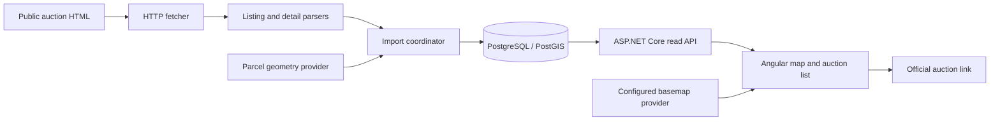

# Fluxus prototype implementation plan

Prepared: 6 October 2026. Status: implementation started; the first working import → PostGIS → API → Angular map slice is available. See [run instructions](../README.md) and the [initial source-validation record](SOURCE_VALIDATION.md). The milestones below remain the full target; this first slice does not complete every milestone.

## 1. Objective and working assumptions

Build a working application that discovers announced and running Lithuanian land auctions, extracts their land parcels, resolves cadastral boundaries, and displays each auction–parcel association on an interactive map of Lithuania. Selecting a marker shows the auction and highlights the selected parcel. The official auction page remains the place to inspect full conditions and participate.

The starting brief is the [shared conversation](https://chatgpt.com/share/6ac527e6-68d4-83eb-b2e9-9459e9f8a147). The user subsequently selected **ASP.NET Core + Angular**. PostgreSQL/PostGIS and MapLibre GL JS are proposed implementation choices, not requirements supplied by the user.

The repository was empty at planning time. This plan assumes one developer, a local/private prototype first, Lithuanian UI text, EUR prices, hectares for land area, and times displayed in `Europe/Vilnius`. It does not assume existing hosting, credentials, or an official auction API.

The first deliverable is evidence that the extraction-to-map pipeline works. The application follows only after that evidence is available.

## 2. Findings checked during planning

| Finding | Evidence and implication |
| --- | --- |
| The source domain is `evarzytynes.lt`. | The [filtered listing](https://www.evarzytynes.lt/evs/pages/auctions.do?estateSubtype=1&estateType=1&listType=1&page=0&stateType=PASKELBTA-IR-VYKSTA) returned readable HTML with auction links, dates, prices, and property summaries. A browser automation scraper is not the initial choice. |
| Filtered results include mixed property bundles. | The same listing includes land alongside buildings. Treat the category as discovery input and inspect the individual property sections. Do not assume the auction consists entirely of land. |
| Parcel identifiers occur within property sections. | A [sample detail page](https://www.evarzytynes.lt/evs/pages/auction.do?id=338243&number=337629) has separate building and land sections. The land section contains cadastral and unique numbers, area, share, address, and a component price. Scope parsing to each section. |
| Geoportal exposes a queryable parcel layer. | A direct HTTP metadata request to the [layer](https://geoportal.lt/arcgis/rest/services/geoportal_teikeju/RC_sklypai_opendata/MapServer/0?f=pjson) returned HTTP 200. Fields include `unikalus_nr`, `kadastro_nr`, `sav_kodas`, `sav_pavadinimas`, and `skl_plotas`. |
| Geoportal returns ArcGIS JSON. | The checked metadata reports version 10.31, polygon geometry, native EPSG:3346, `maxRecordCount=100`, and supported query formats `JSON, AMF`. Build an ArcGIS JSON adapter; do not assume `f=geojson` works. |
| Initial exact geometry matching now works. | A ten-auction implementation sample resolved all eleven land offers to ten distinct cadastral parcels using `outSR=4326` and a 60-second timeout. The [validation record](SOURCE_VALIDATION.md) distinguishes this sample from national coverage; the earlier 20-second trial timed out. |
| A second provider has documented parcel searches. | The [Boundaries API documentation](https://boundaries-openapi.govstartup.lt/) describes parcel identifier searches and EWKT/EWKB geometry with a selectable SRID. It is a candidate alternative; live matching and operational reliability were not tested. |
| Cadastral data is not live auction data. | The [dataset catalogue](https://data.gov.lt/datasets/3158/?resource_version=3015) describes monthly refreshes and possible omissions. Missing geometry must be an explicit supported state. |
| Crawl guidance is unresolved. | A direct request to the auction site's `robots.txt` returned 404. This does not establish reuse permission or an approved request rate. Keep requests conservative and verify source guidance before scheduled/public use. |

These checks establish a reasonable implementation direction. They do not establish complete pagination, permitted republication, end-to-end geometry resolution, or near-100% parcel coverage. Do not carry the conversation's difficulty, hosting-cost, or weekend-effort estimates forward as verified facts.

## 3. Prototype scope

### Required

- Discover announced and running auctions through the land filter; follow pagination and deduplicate source auction IDs.
- Parse every land section in each selected auction, including multiple parcels and shares.
- Retain auctions that bundle land with buildings; label them as mixed bundles.
- Resolve exact parcel geometry using a unique number, then a cadastral number when needed.
- Display one marker per auction–parcel association. A multi-parcel auction has multiple markers opening the same auction.
- Show selected parcel boundaries on demand; cluster nearby markers at country scale.
- Show auction number, source status, start/end time, auction starting price, last observed bid, land area, sold share, location, and official source link.
- Filter by municipality, auction price, sold land area, source status, and end-time range.
- Provide a list of auctions, including entries whose parcels cannot be mapped.
- Run a manual import and an optional scheduled import, with deduplication, last-good-data preservation, and freshness reporting.
- Support fixture mode so development and demonstrations do not depend on external availability.

### Deferred

Accounts, alerts, saved searches, bidding, payments, attachments/OCR, ownership/contact data, price history, valuation, price-per-hectare ranking, satellite layers, parcel editing, full-text cadastral search, geocoding, nationwide cadastral downloads, vector tiles, and a public production launch.

Land-use text can appear in the detail panel when extraction is reliable. A normalized land-use filter is a follow-up because source descriptions and provider codes require a separate mapping.

### What “all land auctions” means initially

The prototype covers all valid land sections discovered through the verified announced/running land listing. M0 must compare this result with the portal's wider real-estate listing to check whether classification hides bundles containing land. If it does, extend discovery to the wider category and retain only auctions with verified land sections.

Until that comparison succeeds, product copy must describe the imported catalogue and last refresh, rather than promise exhaustive national coverage.

## 4. Technology and system structure

| Component | Decision | Reason |
| --- | --- | --- |
| Backend | ASP.NET Core on .NET 10 | User-selected platform; one host can serve the API, static frontend, and importer. See the [official .NET 10 overview](https://learn.microsoft.com/en-us/dotnet/core/whats-new/dotnet-10/overview). |
| HTML parsing | AngleSharp, through ordinary HTTP requests | Parse document structure and labels; keep fetching separate from pure parsing. Confirm current package compatibility when scaffolding. |
| Frontend | Angular 22, standalone components, strict TypeScript, signals, zoneless rendering | User-selected framework. The [compatibility table](https://angular.dev/reference/versions) lists Angular 22 support. Use compatible Node 24.x at or above 24.15.0 and TypeScript 6.0.x; pin exact compatible versions at scaffold time. |
| Frontend data access | Native `fetch` with Angular `resource()` | Cancelable reads and explicit loading/error states. Keep application code free of RxJS; retain Angular's required peer dependency. See [resources](https://angular.dev/guide/signals/resource) and [zoneless rendering](https://angular.dev/guide/zoneless). |
| Map | MapLibre GL JS, direct integration | GeoJSON sources, clustered points, and selected parcel layers. Use its [cluster example](https://maplibre.org/maplibre-gl-js/docs/examples/create-and-style-clusters/) as a starting reference. |
| Storage | PostgreSQL with PostGIS; EF Core/Npgsql | Durable imports, shared parcel cache, valid spatial types, reliable point placement. Pin a mutually compatible, supported database/extension/provider combination after M0. |
| Geometry processing | PostGIS plus an Infrastructure conversion adapter | Persist MultiPolygon geometry in EPSG:4326; generate marker points and GeoJSON centrally. |
| Scheduling | .NET `BackgroundService`, enabled by configuration | One replica and one import at a time. A job platform is unnecessary for the prototype. |
| Local execution | Docker Compose for PostGIS; native backend and Angular dev server | Convenient editing on Windows. Containerize the application for the final repeatable demo. |
| Tests | xUnit, real PostGIS integration tests, Angular CLI Vitest, focused browser journeys | Verify source parsing, persistence, geometry, and visible map behavior at appropriate boundaries. |



The frontend reads cached data only. User interactions never trigger scraping or direct cadastral queries. This prevents visitors from increasing source load and lets the app continue operating during source outages.

### Proposed repository layout

```text
docs/
  PROTOTYPE_IMPLEMENTATION_PLAN.md
  source-validation.md                 # created in M0
src/
  Fluxus.Core/                        # models, rules, use cases, boundary interfaces
  Fluxus.Infrastructure/              # HTTP, parsers, geometry adapters, EF persistence
  Fluxus.Api/                         # endpoints, host, importer scheduling, composition
  Fluxus.Web/                         # Angular app
tests/
  Fluxus.Core.Tests/
  Fluxus.Infrastructure.Tests/
  Fluxus.Api.Tests/
  fixtures/                          # sanitized HTML, provider JSON, expected outputs
deploy/
  compose.yaml
  Dockerfile
scripts/
  import-once.ps1
README.md
```

Use three backend projects because extraction rules need tests independent of network/database dependencies, and the same import use case serves scheduled and manual execution. `Infrastructure` depends on `Core`; `Api` composes both. Keep business rules out of endpoints and provider adapters. Avoid a mediator, generic repository framework, event bus, or an interface for every class.

Use narrow interfaces only at the auction source, parcel resolver, catalogue persistence, and clock boundaries. Keep provider-specific geometry representations and EF entities in Infrastructure. Domain rules operate on identifiers, prices, shares, times, and location outcomes.

## 5. Data model and invariants

### `auctions`

| Field | Type / rule |
| --- | --- |
| `id` | UUID, internal stable identifier |
| `source_auction_id` | Text, unique; extracted from the official detail URL |
| `auction_number`, `source_url` | Text; source number is display metadata, not the only identity key |
| `source_status_raw`, `status` | Raw label plus `announced`, `running`, `ended`, `cancelled`, `unknown` |
| `starts_at`, `ends_at` | Nullable `timestamptz`; invalid/unresolvable dates generate an issue |
| `initial_price_eur`, `last_bid_eur` | Nullable `numeric(18,2)`; absent bid is null, never zero |
| `contains_non_land_assets` | Boolean; controls mixed-bundle wording |
| `first_seen_at`, `last_seen_at` | UTC observation times |
| `listing_observed_at`, `detail_observed_at` | Separate freshness of summary and detail data |
| `content_hash`, `parser_version` | Change detection and parser reprocessing |
| `missing_complete_runs`, `visibility_state` | Catalogue reconciliation, distinct from source auction status |

### `parcels`

| Field | Type / rule |
| --- | --- |
| `id` | UUID |
| `unique_number_normalized` | Nullable text, partial unique index; preserve leading zeroes |
| `cadastral_number_normalized` | Nullable text, partial unique index; documented canonical formatting |
| `geometry` | Nullable `geometry(MultiPolygon,4326)` |
| `marker_point` | Nullable `geometry(Point,4326)`, derived from accepted geometry |
| `municipality_code`, `municipality_name` | Nullable provider attributes |
| `provider_area_ha` | Nullable decimal; do not replace source area with it silently |
| `geometry_provider`, `provider_updated_at`, `geometry_fetched_at` | Provenance and freshness |
| `resolution_status`, `last_attempt_at`, `next_attempt_at` | Resolution outcome and retry scheduling |

At least one validated identifier is required to create a canonical parcel. A section without identifiers remains an unresolved auction item. If incoming identifiers point to different existing parcels, record a conflict and do not merge records automatically.

### `auction_parcels`

This table represents the land item offered in a particular auction. Price and share belong here when they describe that item; geometry belongs to the canonical parcel.

| Field | Type / rule |
| --- | --- |
| `id`, `auction_id`, `parcel_id` | UUIDs; `parcel_id` nullable until matching succeeds |
| `source_item_key` | Stable identifier for the parsed section; unique within the auction |
| `identity_confidence` | `source_id`, `parcel_identifier`, or `section_fingerprint` |
| `unique_number_raw`, `cadastral_number_raw` | Preserve extracted identifiers and diagnostics |
| `address_raw`, `land_use_raw` | Optional cleaned text from the land section |
| `total_area_ha`, `source_sold_area_ha` | Nullable exact decimals with original values/units retained in provenance |
| `share_numerator`, `share_denominator`, `share_raw` | Nullable integer fraction and original wording |
| `derived_sold_area_ha` | Total area × validated share, only when both inputs are known |
| `sold_area_basis` | `source`, `derived`, `unknown`, or `conflict` |
| `area_provenance` | Small structured value containing original area text, unit, precision, and extraction field |
| `component_initial_price_eur` | Optional price explicitly allocated by the source to this land item |
| `parse_status`, `resolution_reason` | Explicit incomplete, ambiguous, missing, or invalid outcomes |

Prefer a source section ID if one is stable. Otherwise match a normalized parcel identifier within the auction. If neither exists, use a normalized section fingerprint and mark its identity confidence as limited. Reordering sections must not duplicate known items; indistinguishable unresolved sections must produce an issue rather than be silently collapsed.

Store hectare values as `numeric(18,8)` and use decimal arithmetic for conversion and shares. Add foreign-key indexes, an auction status/end-time index, municipality indexes, and GiST indexes on geometry/marker points where spatial queries use them. Enforce positive known areas, valid known fractions, geometry SRIDs/types, and the per-auction item-key uniqueness in migrations. Nullable fields must still permit incomplete source observations.

### Operational tables

- `import_runs`: start/end, outcome (`running`, `complete`, `partial`, `failed`, `abandoned`), listing completeness, pages fetched, auctions discovered/updated, items parsed, resolved/unresolved counts, and safe error summary.
- `import_issues`: run, auction/item when known, stage, reason code, field, and a small sanitized diagnostic. Do not store full source pages here.
- Catalogue revision: a monotonic value incremented when published catalogue data changes; used for API caching. Operational-only log changes do not invalidate catalogue data.

### Essential business rules

1. **Auction identity differs from parcel identity.** Several auctions can offer the same parcel. Several parcels can occur in one auction.
2. **A marker identifies an auction item.** Co-located offers must remain separately selectable; cluster counts count auction–parcel associations.
3. **Bundle price is not parcel price.** Every marker can show the total auction price with a clear label. Never allocate it equally across parcels or present it as the selected parcel's price.
4. **A fractional share is not a physical sub-polygon.** Display the full cadastral boundary and the offered fraction. Never cut a boundary to imply exclusive ownership of a particular area.
5. **Area precision matters.** Prefer the more precise source unit within the same field, e.g. ares converted to hectares over a rounded parenthetical hectare value. Keep total and sold area separate.
6. **Missing fields are not defaults.** Use null and an explanation; distinguish an explicitly absent bid from a field that the parser failed to find.
7. **Preserve disagreements.** If source sold area and fraction-derived area disagree beyond documented rounding tolerance, retain both, flag conflict, and exclude the item from sold-area filtering until resolved.
8. **Times have a zone.** Parse portal wall-clock times as `Europe/Vilnius`, convert to UTC, and return explicit offsets/`Z`. Preserve source precision. Ambiguous DST times require a diagnostic rather than a guessed instant.
9. **Elapsed time is not a sale result.** Passing the last observed end time does not prove completion, sale, or cancellation. Show an elapsed/stale observation and refresh the detail before assigning a terminal source state.
10. **Provider purpose is not auction land-use text.** Keep the two provenances separate if both are displayed.

## 6. Import and parsing pipeline

### 6.1 Fetch and discover

Start with the exact filtered URL linked in section 2. Validate real pagination links and filter persistence during M0; do not assume an arbitrary page count.

1. Fetch the listing with an identifying User-Agent and configured timeouts.
2. Parse auction cards and canonical same-origin detail URLs.
3. Record source IDs, status, dates, prices, and a normalized summary hash.
4. Follow the observed next-page convention while preserving filters.
5. Deduplicate source IDs across pages. Stop on verified last-page state.
6. Detect repeated page signatures, unexpected layout, impossible counters, and safety-limit exhaustion. These are incomplete runs, not successful empty results.
7. Re-fetch the first page at the end. If its identity set changed during traversal, repeat discovery once within the request budget or mark completeness uncertain. Ordering can change during a live crawl.

A valid zero-result layout must be recognized explicitly. Missing auction cards without that layout indicates parser drift or an error page. Only complete discovery runs can advance missing-auction reconciliation.

### 6.2 Parse detail pages

Keep fetching and parsing separate. `ParseListing(html)` and `ParseDetail(html)` should be deterministic functions suitable for fixture tests.

- Identify auction metadata and repeated property sections by structural headings and known labels.
- Classify a section as land using its property type/subtype. Do not collect every unique number on the page: building IDs and incidental IDs in descriptions are not land parcel identifiers.
- Extract identifiers, address, precise total/sold area, offered share, land-use text, and any explicitly allocated component price within that section.
- Normalize HTML entities, nonbreaking spaces, Unicode whitespace, EUR suffixes, Lithuanian decimal separators, and units.
- Use validated regular expressions only on scoped field values or scoped fallback descriptions.
- Allow absent optional fields; report missing required auction identity or an unrecognizable property structure as a failed parse.
- If a land identifier occurs only in a description, accept it only when the description unambiguously refers to that section's land. Otherwise keep the item unresolved.
- Escape all text when displayed. Do not republish source HTML, organizers' contacts, owners, bank details, or payment instructions.

Parse issues carry reason codes such as `missing_identifier`, `ambiguous_identifier`, `invalid_share`, `area_conflict`, `invalid_date`, and `layout_changed`.

### 6.3 Update policy

Initial defaults are engineering settings to tune after source validation, not approved limits:

| Work | Default |
| --- | --- |
| Listing discovery | Every 60 minutes |
| New auction detail | On discovery |
| Changed listing summary | Re-fetch detail in the same run |
| Unchanged active detail | At least every 6 hours, since summary hashes can miss description changes |
| Auction near/past last known end | Re-fetch detail on the next run; no promise of live bids |
| Accepted geometry | Cache for 30 days; refresh separately from auction observations |
| Confirmed identifier with no geometry | Retry after 24 hours, then every 7 days |
| Provider outage/timeout | Short backoff, separate from a confirmed not-found cache |

Fetch one request at a time per source, with a configurable starting delay of two seconds plus jitter. Honor `Retry-After`; use capped exponential backoff for transient errors. Stop the source's work after repeated failures or an access challenge. Do not introduce authentication, CAPTCHA handling, or proxy rotation.

A list request gets a reasonable finite timeout; parcel queries initially get up to 60 seconds because the planning probe timed out at 20 seconds. Limit retries to two, cap run duration and total requests, and record when limits stop a run. Tune against measured source behavior rather than increasing concurrency.

### 6.4 Write safely and reconcile

1. Acquire a process guard and a PostgreSQL advisory lock using a dedicated connection. A second importer exits without starting work.
2. Create an `import_runs` record. Propagate cancellation through HTTP and database calls.
3. Stage/validate parsed updates before writing. Use a transaction per auction for metadata and its item associations.
4. Replace an auction's item associations only after a complete detail parse. A failed or partial page must not remove previously valid parcels.
5. Preserve previous values on fetch/parse failures. Successfully parsed explicit changes, including an absent last bid, can replace old values; field-not-found errors cannot.
6. Record provider failures independently; a geometry outage does not prevent saving auction metadata.
7. On complete discovery, mark observed auctions as seen and increment missing counters for previously active auctions that were not seen.
8. After two complete misses, recheck the detail. Confirmed terminal status can remove it from active results. If the detail remains active, retain it with a warning. Unavailable details become `source_missing`, not `sold`; retain them in the diagnostic/list view.
9. Partial/failed discovery never advances missing counters. A failed source refresh never clears the map.
10. Finalize run counters/outcome and release the lock. Mark stale running records `abandoned` on recovery after an interrupted process.

Manual execution invokes the same use case through a one-shot host mode such as `--import-once`; it is not a public HTTP endpoint. Scheduling is off in tests and fixture mode.

## 7. Parcel matching and geometry

### 7.1 Primary adapter: Geoportal

Use the verified layer as the initial provider. An intended exact-number request is:

```text
GET https://geoportal.lt/arcgis/rest/services/geoportal_teikeju/RC_sklypai_opendata/MapServer/0/query
  ?where=unikalus_nr='440012360279'
  &outFields=unikalus_nr,kadastro_nr,sav_kodas,sav_pavadinimas,skl_plotas,data_rk
  &returnGeometry=true
  &outSR=4326
  &f=json
```

This is a proposed request shape, not a successful geometry result from planning. URL-encode parameters. Construct `where` expressions only from validated identifier characters; never interpolate arbitrary input. Query parameter semantics are documented by [Esri](https://developers.arcgis.com/rest/services-reference/enterprise/query-map-service-layer/).

Try the normalized unique number first. If it yields no exact match, try the cadastral number using the provider's verified formatting. Preserve the raw identifiers and define the conversion from actual samples. If both supplied identifiers disagree with the returned record, classify the outcome as a conflict rather than accepting the first result.

Inspect ArcGIS error objects even under HTTP 200. Validate exact returned identifiers, spatial reference, geometry presence, and transfer-limit flags. Keep initial requests small and exact; if batching is added, stay below the layer's 100-record ceiling and handle pagination explicitly.

### 7.2 Convert and validate

- Decode ArcGIS polygon rings using a tested converter, preserving outer rings, holes, and separate parts. A flat list of rings must not be blindly treated as one GeoJSON Polygon.
- Request linearized output and verify actual response shapes; unexpected curve geometry is an explicit unsupported outcome until the adapter handles it.
- Confirm returned CRS. If it remains EPSG:3346, use a real coordinate transformation to EPSG:4326; assigning an SRID alone does not transform coordinates.
- Require a nonempty, valid Polygon/MultiPolygon. Normalize Polygon to MultiPolygon for storage.
- Check finite coordinates and plausible Lithuania bounds. Use approximately longitude 20.5–27.0 and latitude 53.7–56.6 as a sanity check, not a substitute for parcel identity verification.
- Do not silently repair malformed geometry into a different boundary. Keep the previous accepted geometry and record an issue; fixture-backed repair can be added later if needed.
- Derive a marker using `ST_PointOnSurface(geometry)`, which keeps it within the parcel surface, unlike some centroids. See [PostGIS documentation](https://postgis.net/docs/ST_PointOnSurface.html).
- Emit GeoJSON as `[longitude, latitude]`. Use projected EPSG:3346 if geometric area comparisons are needed; never calculate hectares from square degrees.
- Store provenance and fetch time. A cadastral boundary does not establish the geographic shape of an ownership share.

### 7.3 Alternative provider and unresolved parcels

If Geoportal fails the M0 gate, test the documented Boundaries API. Its intended search contract is:

```text
POST /v1/parcels/search?srid=4326&geometry_output_format=ewkt
Content-Type: application/json
{"filters":[{"parcels":{"unique_numbers":[440012360279]}}]}
```

The request is a read-only search. The provider's documentation uses numeric unique-number inputs; keep domain identifiers as strings and convert only validated values at this adapter boundary. Confirm cadastral search formatting, actual EWKT/SRID, exact match behavior, limits, attribution, and availability during the spike.

Select one working provider for the prototype. Do not build and maintain two live adapters unless the primary demonstrably needs the fallback. A geometry-provider boundary should make that decision cheap to change.

Supported outcomes are `resolved_exact`, `missing_identifier`, `not_found`, `ambiguous`, `identifier_conflict`, `invalid_geometry`, and `provider_unavailable`. Unresolved items stay in the catalogue without a map point. The prototype does not geocode them to a village center or invent a location.

## 8. Read API contract

Serve API and frontend on the same origin for the containerized prototype. Use DTOs rather than exposing EF entities. Return safe Problem Details for invalid requests and unexpected failures.

| Endpoint | Purpose |
| --- | --- |
| `GET /api/catalog/map` | Filtered GeoJSON point FeatureCollection with catalogue metadata; no full parcel polygons |
| `GET /api/auctions` | Paged auction cards, including unresolved items; same shared filter rules |
| `GET /api/auctions/{id}` | Auction metadata and all its land items, resolution outcomes, and freshness |
| `GET /api/auction-parcels/{id}/geometry` | Selected item's accepted MultiPolygon and geometry provenance |
| `GET /api/catalog/filters` | Municipality values actually present in the catalogue |
| `GET /api/catalog/status` | Last complete/attempted run, coverage, stale/degraded state; no raw logs |
| `GET /health/live`, `GET /health/ready` | Process and database health; source outages are reported separately |

### Filters and counting

- `status=announced,running` by default; unknown/elapsed observations remain explicitly labeled.
- `municipalityCode`, `minPriceEur`, `maxPriceEur`, `minSoldAreaHa`, `maxSoldAreaHa`, `endsAfter`, `endsBefore`.
- Price filtering uses the **auction starting price**, never an invented parcel price or an unstable last bid.
- Sold-area filtering uses the item's trusted source area, or derived area when the source sold area is absent. Unknown/conflicting areas do not match an explicit numeric range.
- Municipality/area filters match items. The auction list includes an auction if any land item matches, and explains its matching-item count.
- Map counts distinguish matching auctions, matching items, resolved markers, and unresolved items. A multi-parcel auction is one auction and several items.
- Unresolved items can match municipality only when a trustworthy provider code or verified source-to-code mapping exists. Do not silently fuzzy-match municipality names.
- Reject negative values, inverted ranges, invalid codes/times, and unsupported sort fields with HTTP 400.

The map response includes GeoJSON foreign members such as `catalogueVersion`, `generatedAt`, `lastCompleteImportAt`, and the counts above. Feature `id` is the auction-item UUID. Properties contain only compact card data; dates are ISO 8601 and prices/areas are nullable JSON numbers with explicit meanings.

For the prototype, return all matching points for Lithuania so clustering and counts remain coherent. Set a 5,000-feature guardrail; if exceeded, return a deliberate `catalogue_too_large` error and require narrower filters. Never silently truncate. Reassess using measured M0/full-crawl counts before implementation; viewport queries/vector tiles are a later optimization.

The auction list uses page sizes up to 100, deterministic sorting by end time then ID, with null dates last. Its response carries the catalogue revision; if revision changes during paging, the client resets pagination. Read related counts and features in one consistent database snapshot. Support ETag/conditional requests keyed by catalogue revision and normalized filters.

Geometry retrieval returns 404 for an unknown item, 200 with an explicit unresolved state and null geometry for a known unresolved item, and 200 with geometry for a resolved item. The browser can distinguish “parcel cannot currently be located” from a missing catalogue record.

## 9. Angular user experience and implementation

### Primary screen

Desktop: a full-height map with a filter/results side panel. Mobile: map/list toggle, a filter sheet, and a detail panel that does not obscure all map controls. Provide a useful list when WebGL or basemap loading fails.

1. Open on Lithuania, approximately centered at longitude 23.9 / latitude 55.2, with announced/running imported auctions.
2. Show a compact freshness line and counts, e.g. auctions, mapped parcels, and parcels without location.
3. Apply filters explicitly. Label price as auction starting price and area as sold land area.
4. Zoom into clusters; selecting a marker highlights it and opens the auction card.
5. Load the selected parcel boundary on demand. The auction card lists other parcels in the same lot, with actions to select each.
6. Show an ownership-share badge and mixed-bundle badge where relevant. The panel labels total parcel area, offered share, sold area, and total auction price distinctly.
7. Open the canonical official auction URL in a new tab with safe external-link attributes.
8. Show unresolved items in the list with an understandable reason and official source link.

### Components and state

- `AuctionMapPage`: composes filters, counts, map, list, and detail panel.
- `AuctionMapComponent`: owns MapLibre initialization, layers, interaction listeners, and disposal.
- `AuctionFiltersComponent`: native labeled inputs/selects; draft values committed with Apply/Reset.
- `AuctionListComponent`: one card per auction and matching-item counts.
- `AuctionDetailsComponent`: full lot information, item selector, and source action.
- `CatalogStatusComponent`: loading, stale-data, degraded-source, and coverage summaries.
- `CatalogApi`: URL construction, native fetch, HTTP error translation, and runtime response validation.
- A small page-scoped signal store: applied filters, selected item, list page, and view mode. Use `computed()` for derived UI state.

Use standalone components, signal inputs/outputs, `OnPush`, native `@if`/`@for` with stable IDs, and zoneless rendering. Use stable `resource()` for map/list/detail reads, forwarding its AbortSignal to `fetch`. Handle idle/loading/error/empty/resolved states explicitly. Do not introduce NgModules, application Observables, `HttpClient`, subscriptions, async pipe, or ZoneJS.

Use effects only at the imperative MapLibre boundary, e.g. updating a GeoJSON source from resolved data or highlighting a selected item. Register map listeners once, update Angular signals from callbacks, and remove listeners/map instances on destruction. Selection changes cancel obsolete geometry reads; a late response must not highlight the wrong parcel.

Persist applied filters and selection in URL query parameters. Validate them on initial navigation and restore them on back/forward navigation using a signal/native-event approach. Avoid experimental form APIs: native input bindings and signals are enough for these filters.

### Map and display details

- Use a GeoJSON source with MapLibre clustering; draw point circles/symbols instead of thousands of DOM markers.
- A cluster represents item offers, not distinct auctions. Distinguish this in counts and any cluster tooltip.
- For co-located offers at maximum zoom, open a small choice list rather than making one offer inaccessible.
- Use separate selected-boundary fill and outline layers. Fit to the whole MultiPolygon, including separate parts.
- Keep auction details in an Angular panel rather than injecting raw HTML into map popups.
- Use `Intl.NumberFormat('lt-LT')` and `Intl.DateTimeFormat` with `Europe/Vilnius`.
- Retain visible attribution for the chosen basemap and cadastral data. Provider selection and current usage conditions are an M0/setup decision; MapLibre is the renderer, not a tile service.
- Cover initial empty catalogue, no matches, API failure, unavailable geometry, stale observations, tiles failure, and WebGL failure. A basemap error must not erase a usable auction list.
- Provide keyboard-accessible filters/cards, Escape to close details, sensible focus restoration, and status text independent of color. A keyboard user can reach all auctions through the list.

## 10. Ordered delivery milestones

Estimates are developer-hours for someone comfortable with ASP.NET Core and Angular. They include focused verification. They exclude unresolved source access changes, external provider changes, and public-launch requirements. Each milestone should be a reviewable change.

| Milestone | Work and concrete deliverable | Depends on | Estimate |
| --- | --- | --- | --- |
| M0: prove source chain | Source inspection notes, 10-auction extraction report, sanitized fixtures, successful geometry examples, coverage and pagination findings | None | 5–8 h |
| M1: scaffold | Pinned toolchain, three-project backend, Angular shell, PostGIS Compose, fixture mode, health endpoints, basic CI | M0 go decision | 3–5 h |
| M2: parser | Pure listing/detail parsers, typed outputs, normalization, multi-item/share/bundle handling, fixture tests | M0, M1 | 6–9 h |
| M3: storage and geometry | Migrations, exact matching adapter, geometry conversion, parcel cache, idempotent manual import | M2 | 7–11 h |
| M4: read API | Filter semantics, map/list/detail/geometry/status DTOs, revision/ETag behavior, integration tests | M3 | 4–7 h |
| M5: map vertical slice | Real API → clustered map → selectable lot → selected boundary → source link | M4 | 6–9 h |
| M6: complete UX | Filters, unresolved list, multi-parcel/co-located selection, mobile layout, freshness and failure states | M5 | 5–8 h |
| M7: safe refresh | Scheduler, locks, bounded retries, reconciliation, stale-data preservation, interruption recovery tests | M3; M6 for UI evidence | 4–6 h |
| M8: repeatable demo | Container build, setup guide, fixture demo, live full-crawl review, acceptance journeys and report | M0–M7 | 3–5 h |

**Total: 43–68 developer-hours; approximately 52–82 hours with 20% contingency.** Roughly one to two working weeks for one developer. M0 alone is the appropriate first commitment. A successful thin live map should be reviewable by M5; M6–M8 make it a reliable prototype.

### M0 checklist and decision gate

- [ ] Inspect raw HTML, response encoding, source links, pagination, zero-result state, and announced/running labels.
- [ ] Select 10 distinct current auctions, taking enough listing pages to obtain variety: whole parcel, fractional share, rural address, mixed bundle, and multi-parcel lot. If a case is not available live, document the gap and add a separately labeled fixture.
- [ ] Record all land sections in those auctions. Do not define success using only the first parcel in each auction.
- [ ] Extract auction IDs, prices, dates, land identifiers, areas, and shares; compare every sample with its source page.
- [ ] Compare land-filter discovery with broader real-estate discovery to assess bundle coverage.
- [ ] Probe one geometry provider sequentially with the sample identifiers. If it fails, test the documented alternative before making a decision.
- [ ] Verify CRS, holes/parts, returned identifiers, coordinate plausibility, and observed latency. Check at least three boundaries visually against source location descriptions and cadastral context.
- [ ] Capture sanitized, minimal fixtures and expected normalized outputs. Keep raw live HTML untracked and temporary; it can include personal/payment information.
- [ ] Record request counts, failures, parser warnings, provider outcomes, and identifier formatting in `docs/source-validation.md`.
- [ ] Check source guidance and select a usable basemap/attribution configuration for the intended private demo.

The report has one row per land item: auction/item ID, raw/normalized identifiers, total/sold area, share, chosen provider, resolution outcome/reason, and manual verification result.

**Go:** all 10 auction identities and valid source links are correct; every manually identified land section is represented without building-ID contamination; all mapped geometries have exact identifier matches; at least 90% of sampled items with valid identifiers resolve automatically; the remaining failures have explicit reasons; at least one provider returns usable geometry within the bounded request policy.

The 90% threshold is a prototype decision target, not a statistically supported coverage claim. Also report resolved items divided by *all* discovered land items so missing identifiers cannot disappear from the denominator.

**Revise:** extraction works but resolution falls below target. Diagnose formatting, provider, and dataset omissions; test a larger 30-auction sample before changing scope. A map with limited coverage is acceptable only with documented coverage and unresolved-list behavior.

**Stop the live-map path:** neither provider can yield trustworthy geometry, or listing/detail extraction cannot be performed under the available source access conditions. Preserve the fixtures and evidence; use a fixture-backed UI only as a labeled design prototype. Do not present it as a verified live service.

### Suggested task sequence inside each milestone

1. M1: create solution/projects → pin SDK/npm versions → database health/migrations → Angular shell/proxy → fixture-mode flag → CI skeleton.
2. M2: listing fixtures → detail-section segmentation → field normalization → typed parse issues → multi-item and failure cases.
3. M3: schema → one-auction transactional upsert → one-parcel resolver → polygon conversion/validation → cache/retry metadata → repeated-import verification.
4. M4: shared filter evaluator/query → compact GeoJSON → detail/geometry → unresolved list → metadata/ETag → bounded-input and consistency tests.
5. M5: map source/layers → marker selection → detail resource → boundary layer → official link → first live demo.
6. M6: apply/reset filters → auction paging → same-lot item selection → co-located offers → mobile/focus handling → failure/freshness states.
7. M7: one-shot import → scheduler → locking/cancellation → complete-run detection → missing-record policy → outage/recovery verification.
8. M8: image/Compose → clean setup → fixture demo → one full live import → acceptance evidence → README and limitations.

## 11. Verification and acceptance

### Focused automated tests

| Area | Behavior to verify |
| --- | --- |
| Listing parser | Filtered cards, source-ID deduplication, pagination, legitimate empty layout, layout/challenge detection |
| Detail parser | Multiple land sections, mixed bundles, section-scoped IDs, absent bid, comma decimals, nonbreaking spaces, ares/hectares, share extraction, rounded-area precision |
| Domain rules | Positive share denominator, valid fraction, area conflict, bundle-price labels, source-time conversion/DST ambiguity, null semantics |
| Geometry | Exact identifiers, rings with holes, MultiPolygon, invalid/empty output, CRS transformation, point within parcel, `[lon,lat]`, ArcGIS HTTP-200 errors |
| Persistence | Import twice with no duplicate auctions/items, reorder sections, same parcel in multiple auctions, transactional item replacement, failed parse preserves previous items |
| Refresh | Partial crawl never closes auctions, two complete misses trigger detail check, failed geometry refresh retains boundary, lock prevents overlap, interruption recovery |
| API | Filter semantics/counts, nullable fields, stable pagination/revision changes, ETags, unresolved geometry response, invalid range rejection, no unbounded output |
| Angular | Loading/error/empty/stale states, price/area labels, applied-filter URL restore, canceling obsolete selection, selecting another parcel in the same lot |

Use real PostGIS for spatial and database-constraint integration tests; an in-memory EF provider cannot establish those behaviors. CI uses fixtures/fake HTTP responses, not live auction or geometry services. Keep live smoke checks manual or deliberately scheduled and rate-limited.

Run `dotnet build`, backend tests, Angular checks/tests, and a production frontend build as part of implementation. Follow generated tooling conventions and configure formatting once; do not add duplicate verification tools. No application tests apply to this planning-only change.

### End-to-end acceptance journeys

1. A clean checkout can start the documented fixture demo without external services or secret credentials.
2. Manual live import produces a report of discovered auctions, land items, exact mapped items, and unresolved reasons.
3. Repeating an import changes observations but creates no duplicate catalogue records or markers.
4. A multi-parcel auction shows multiple selectable markers and one auction card. Co-located offers remain accessible.
5. A fractional-share item shows the full parcel boundary and offered share; sold area is correctly labeled.
6. A mixed lot clearly identifies its total auction price and included non-land assets. It never implies that bundle price buys only the selected land parcel.
7. Applying/resetting each filter updates map/list/counts consistently; invalid ranges produce helpful feedback.
8. A known unresolved item is visible in the list without a fabricated map point.
9. During auction/provider outages, last accepted data remains usable with accurate stale/degraded metadata.
10. Selection highlights the correct boundary and opens the correct official source page; rapidly changing selection cannot draw an old response.
11. Mobile and keyboard users can inspect all offers through the list; WebGL failure leaves the list usable.
12. A full listing pass reconciles source IDs and parsed land items with the reported counts. Any missing classifications or parser failures are quantified.

### Performance budgets

Treat these as targets to measure, not current results: filtered cached API p95 below 500 ms on the demo machine; initial API point payload below 2 MB compressed; usable map within 3 seconds on a normal desktop connection; selected detail/boundary within 1 second after cached API response. Measure against the actual catalogue and a synthetic 5,000-point fixture. Basemap/network latency must be reported separately.

## 12. Configuration, operation, and delivery

Configure: database connection, fixture/live mode, importer enabled flag, 60-minute interval, per-source delay/timeouts/retries, maximum pages/requests/run duration, detail refresh interval, geometry cache TTL, provider URL, basemap style URL/attribution, and stale-data threshold. Validate options at startup. Keep secrets outside tracked files and supply only placeholders in `.env.example`.

Freshness has three meanings: last complete discovery, each auction's last detail observation, and each parcel's geometry fetch/provider update. The status strip must not imply that all three refreshed together. Mark catalogue discovery stale after two missed planned cycles (initially two hours), and distinguish auction-source failures from geometry-provider failures.

Use structured logs with import/run/auction identifiers and reason codes. Record source request counts/latency, discovery completeness, parser failures, exact-resolution ratio, and unresolved counts. Logs and API status contain safe summaries, not raw HTML or contact/payment information. An import with zero records after previously nonzero records is a diagnostic event requiring the validated empty-state checks.

Local development uses PostGIS Compose, an ASP.NET Core API, and Angular's dev-server API proxy. The final demo serves the built Angular app from the same ASP.NET Core container alongside a database container and persistent volume. Apply migrations through an explicit setup step. Keep the importer single-replica; verify restart persistence and one database backup/restore before relying on stored live data.

Do not expose the database or import-control mechanism publicly. Public read access is outside this initial private-demo assumption; a later hosted pilot needs a confirmed deployment destination, source reuse/attribution review, chosen basemap service, backup and refresh monitoring, and measured capacity. Hosting cost should be estimated only after those choices are made.

Final prototype delivery contains:

- The implementation and locked dependencies.
- A README with prerequisites, configuration, fixture demo, live import, scheduling, and troubleshooting commands.
- Sanitized fixtures and expected outputs.
- `source-validation.md` with M0 and full-crawl evidence, actual coverage denominators, provider findings, and remaining limits.
- API documentation plus a concise demo script covering a whole parcel, a share, a mixed lot, a multi-parcel lot, and an unresolved item.
- The acceptance results and measured performance, with any failed/unverified items identified.

## 13. Decisions to revisit only when evidence requires it

| Question | Default now | Trigger for change |
| --- | --- | --- |
| Is land-filter discovery exhaustive? | Use it provisionally | M0 comparison finds land in auctions absent from that filter |
| Which geometry provider? | Geoportal first | Live lookup reliability/coverage fails M0; test Boundaries API |
| Is country-wide GeoJSON enough? | Yes, up to 5,000 matching offers | Measured count/payload exceeds budget |
| Is a job system needed? | No, single host BackgroundService | Multiple replicas or independent job delivery becomes necessary |
| Should unresolved items use geocoding? | No | A separate user requirement accepts approximate locations and explicit confidence labeling |
| Should price-per-hectare be shown? | No | Lot/component-price and mixed-asset semantics can be established without misleading allocation |
| Is a public launch included? | No, private prototype first | User requests a hosted pilot and the corresponding source/deployment decisions are resolved |

The implementation starts with M0, then proceeds through the smallest real vertical slice: one correctly parsed auction, one exactly matched parcel, one persisted record, one API feature, and one selectable map boundary. That slice establishes the core behavior before expanding discovery, filters, scheduling, and presentation.
